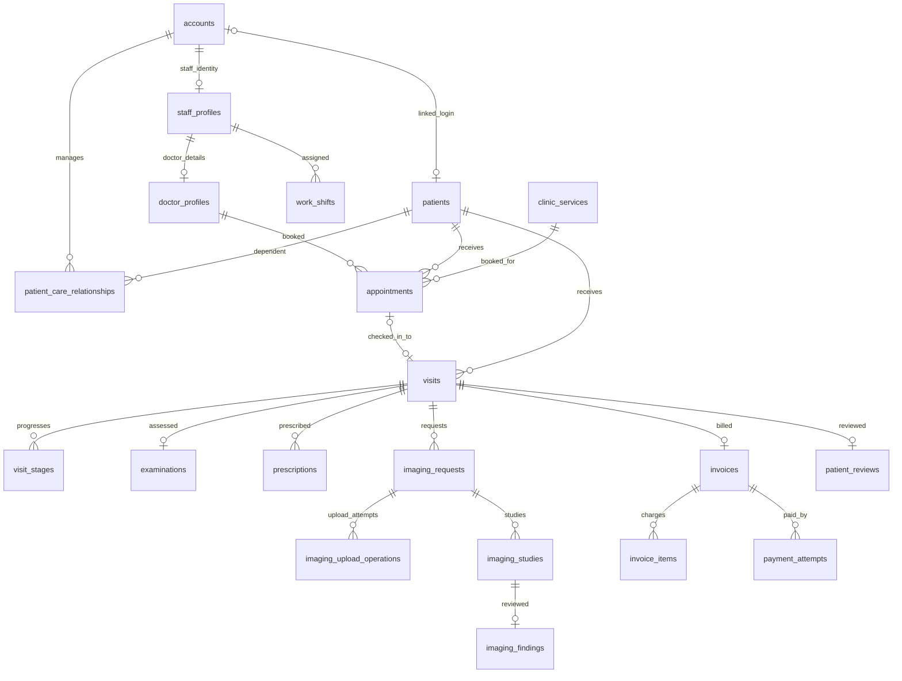

# OTCMS PostgreSQL schema — architecture proposal

Status: **PENDING HUMAN REVIEW**. This document and [`otcms-schema-proposal.sql`](otcms-schema-proposal.sql) are design artifacts, not approved Flyway migrations. Source: `FA26_SEP490_G58_Report3_Software_Requirement_Specification (1).docx`, especially UC-06, UC-10..UC-79 and BR-09..BR-71; `CONSTITUTION.md`, `AGENTS.md`, `CLAUDE.md`, `.sdd/architecture-profile.md`, `otcms/docs/architecture.md`, and `V001__auth_schema.sql`. The SRS's old *Entities Description* names dentists, odontograms and dental inventory; those contradict the orthopedic use cases and are not modeled here.

## A. Assumptions and decisions

1. `V001__auth_schema.sql` is applied and remains immutable. The approved backend auth model (`accounts`, `patient_profiles`, challenge/session/consent/audit) remains authoritative for login. The frontend's separate Supabase Auth flow is a known integration conflict; this proposal does not silently bind `auth.users` to `accounts`.
2. `patients` is the longitudinal clinical identity, separate from a login. A registered person may have one linked account; walk-in and dependent patients have no account. A confirmed `patient_care_relationships` row grants a potential relationship, but backend policy still checks current authorization per action and record.
3. `patient_profiles` in V001 is auth-owned onboarding data. It is not repurposed for walk-in patients. A future approved migration/backfill will establish `patients.account_id` for existing patient accounts and reconcile demographics; no production dual-write is assumed.
4. UUID keys match V001 and externally referenced clinical records. Application services create UUIDs and set `updated_at` on updates. All timestamps are UTC-capable `timestamptz`; local display uses clinic timezone. Money uses `numeric(14,2)` in VND by current assumption. Multi-currency payment attempts have an explicit currency code; invoice currency policy requires product review.
5. Room and staff availability, patient matching, clinical release, invoice amount limits, and provider callbacks need transaction/service policy in addition to DB constraints. The DDL is a structural baseline, not permission to activate routes or deploy integrations.
6. CCCD and health-insurance identifiers are deferred: the SRS does not define whether they are mandatory, who verifies/views them, retention, encryption/search policy, or consent. The schema deliberately does not store them or clinical payload in auth metadata.
7. `btree_gist` must be approved/available to the migration role. It supports UUID equality in GiST exclusion constraints. No destructive alteration of V001 is included.

## B. ERD / relationships



Additional relationships: `rooms` N:N `clinic_services` through `room_supported_services`; `visit_stages` 1:N `queue_position_events`; `patients` 1:N `patient_medical_history_entries`; `visits` 1:N `clinical_documents`; `prescriptions` 1:N `prescription_items`; `patient_reviews` 1:N `review_moderation_events` and 1:0..1 `review_replies`; `accounts` 1:N `notifications` and `activity_audits`.

## C. Schema design

| Capability | Tables, key/relationship | Required and optional data; business invariant |
|---|---|---|
| Auth (existing V001) | `accounts`, `patient_profiles`, `external_identities`, `consent_evidence`, OTP/reset challenges, `auth_sessions`, `authentication_audits`; UUID keys | Unique normalized email, hashed secrets, pending verification. No edits proposed. |
| Patient identity | `patients.id`; optional unique `account_id`; `patient_care_relationships.id` | Name, DOB, gender required; phone optional and non-unique. A merged record retains its historical FK target pending approved merge workflow. Relationship history is retained after access ends. |
| People/operations | `staff_profiles.account_id`; `doctor_profiles.staff_account_id`; `work_shifts.id`; `rooms.id`; `clinic_services.id`; `room_supported_services` composite PK | One staff profile per staff account; doctor profile extends staff. Codes/licenses unique. Room-service N:N. Historical staff and service rows are retained by RESTRICT FKs. |
| Booking/reception | `appointments.id`, `visits.id`, `visit_stages.id`, `queue_position_events.id`, `appointment_time_changes.id` | One visit per appointment, optional appointment for walk-in. Visit patient must match appointment patient. Shift and active booking overlap are blocked by exclusion constraints; room must support each assigned stage service. Service price is snapshotted at visit stage; queue reorder history is append-only. |
| Clinical | `patient_medical_history_entries.id`, `examinations.id`, `clinical_documents.id`, `prescriptions.id`, `prescription_items` composite PK | Document rows contain private MinIO object references, MIME/checksum/size and version, not bytes. Snapshot medicine text is intentional prescription history. Draft vs completed/released states are distinct. |
| Imaging | `imaging_requests.id`, `imaging_upload_operations.id`, `imaging_studies.id`, `imaging_findings.study_id` | PostgreSQL stores request, safe operation state, StudyInstanceUID and Orthanc reference; DICOM bytes remain in Orthanc. Unique UID/idempotency key and request-matching composite FK prevent duplicate/wrong-operation link. |
| Billing | `invoices.id`, `invoice_items` composite PK, `payment_attempts.id` | One invoice per visit is a **provisional MVP rule**. Invoice item price/description snapshots intentionally preserve historic charge; payments have unique idempotency and gateway reference. Invoice total/paid/due are derived, not stored. |
| Engagement and governance | `patient_reviews.id`, moderation/reply, `notifications.id`, `website_contents.id`, `announcements.id`, `activity_audits.id` | At most one review per visit; moderation history is append-only. Notification read state belongs to recipient. Operational audit contains IDs and safe codes, no patient names or raw clinical data. |

The active SRS use-case list covers staff profiles and shifts, but not employee contracts, leave approval, payroll, stock or chat workflows. Those names appear in the stale dental entity catalogue or role overview without matching orthopedic UC/business rules. Adding tables for them now would invent behavior; they require separate SPEC, retention, authorization and accounting policy. Likewise reports/dashboard are read models over source tables, not new transactional tables in this proposal.

## D. PostgreSQL DDL

See the complete, dependency-ordered [`otcms-schema-proposal.sql`](otcms-schema-proposal.sql). It contains CREATE TABLE, explicit PK/FK, UNIQUE, CHECK, defaults and workload indexes. It is intentionally outside `src/main/resources/db/migration/` until feature specs, migration phases and review are approved. The SQL assumes V001 tables already exist, but its cross-feature columns and states still need corresponding Spring entities/services and integration tests before use.

## E. Index strategy

| Index/group | Columns | Query pattern and cost |
|---|---|---|
| `idx_patients_name_dob`, `idx_patients_phone` | lower(name)+DOB; phone when present | Staff-assisted duplicate candidate search (BR-18). Not a definitive identity match; each extra index increases write cost. |
| `uq_care_current`, `idx_care_patient_status` | manager+patient partial unique; patient+status | Prevent duplicate active care link; check manager authorization and reverse lookup. |
| `ex_shifts_staff_overlap`, `idx_shifts_staff_start` | staff+time range; staff+start | Exclude overlapping active shifts (BR-29), list calendar. GiST costs more to maintain than B-tree. |
| `ex_appointments_doctor_overlap`, `idx_appointments_doctor_start`, `idx_appointments_patient_start` | doctor+time range; doctor/start; patient/start | Concurrent booking protection and availability/history lookup (BR-25). Exclusion cannot by itself prove shift coverage. |
| `idx_stages_room_status_entered`, `idx_visits_open` | room/status/arrival; open visit/check-in | Bounded operational queue and current visit screens. Partial indexes avoid archived rows. |
| `idx_imaging_worklist`, `idx_imaging_operations_reconcile` | status/request time; incomplete operation status/update time | Technician worklist and aged reconciliation. Partial indexes favor active rows. |
| `idx_invoices_issued`, `idx_payments_invoice_status`, `idx_payments_confirmed` | issued; invoice/status/time; confirmed time | Billing list, invoice balance calculation, settlement reporting. Unpaid balance remains computed or later approved projection. |
| `idx_reviews_public`, `idx_notifications_inbox`, `idx_notifications_unread` | published time; recipient/time; unread recipient/time | Public reviews and paged inbox. |
| `idx_activity_audits_time`, `idx_activity_audits_resource`, `idx_activity_audits_actor` | time; resource+ID+time; actor+time | Oversight reports without indexing raw payload. Audit growth calls for retention/partition policy after workload evidence. |

Primary and UNIQUE constraints already create indexes; the proposal avoids duplicate single-column indexes where a leading composite key serves the query. FK indexes are included for frequently joined child tables, while low-traffic author references rely on broader audit/query planning until measured.

## F. Data integrity and concurrency

- DB-enforced: email uniqueness in V001; one account per patient; current care relationship uniqueness; code/license uniqueness; non-overlapping active staff shifts and doctor bookings; visit patient/appointment patient match; upload operation/request match; unique DICOM StudyInstanceUID and Orthanc ID; unique invoice/visit; price/quantity/rating/temporal checks; idempotent payment reference.
- Service-enforced with transactional row lock/optimistic version and authorization: patient matching, account type of linked patient/staff, doctor role for doctor profile, shift coverage, eligibility of service/room, reschedule vs shift changes, one active room occupancy, stage order and close prerequisites, report/study release, payment aggregate not exceeding invoice total, correct gateway signature and callback deduplication, review eligibility, actor access, and lifecycle transitions. These cannot be faithfully captured with simple row CHECK constraints.
- External consistency: upload operation is persisted before Orthanc write; an external success with DB failure becomes `RECONCILIATION_REQUIRED` and is retried by identifier, not blind re-upload. Payment callback writes must verify provider evidence, lock invoice, and commit attempt+state atomically. Neither workflow has an approved implementation yet.
- No `ON DELETE CASCADE` is used for core clinical, financial or audit records. Retention, anonymization and hard deletion require separately approved policy. Column-level sensitivity, private bucket access, safe logs and role-scoped query filters are implementation obligations.

## G. Representative queries

```sql
-- Doctor availability candidates: shifts and non-cancelled appointment ranges.
SELECT s.id, s.starts_at, s.ends_at
FROM work_shifts s
WHERE s.staff_account_id = :doctor_id
  AND s.shift_status = 'ASSIGNED'
  AND s.starts_at < :window_end AND s.ends_at > :window_start
ORDER BY s.starts_at;

-- Current queue (keyset/page size enforced at API boundary).
SELECT vs.id, vs.visit_id, vs.entered_at, vs.status
FROM visit_stages vs
WHERE vs.room_id = :room_id AND vs.status IN ('WAITING','IN_PROGRESS')
  AND (vs.entered_at, vs.id) > (:cursor_time, :cursor_id)
ORDER BY vs.entered_at, vs.id
LIMIT :page_size;

-- Balance: confirmed payments only; no mutable total/paid/due copies.
SELECT i.id,
  COALESCE((SELECT sum(ii.quantity * ii.unit_price_snapshot)
            FROM invoice_items ii WHERE ii.invoice_id = i.id),0) AS total,
  COALESCE((SELECT sum(p.amount) FROM payment_attempts p
            WHERE p.invoice_id = i.id AND p.status = 'CONFIRMED'),0) AS paid
FROM invoices i WHERE i.id = :invoice_id;

-- Reconciliation worklist, bounded and safe for keyset pagination.
SELECT id, request_id, external_study_uid, status, updated_at
FROM imaging_upload_operations
WHERE status IN ('PROCESSING','RECONCILIATION_REQUIRED','CONFLICT')
  AND updated_at < :age_cutoff
ORDER BY updated_at, id LIMIT :page_size;
```

These are structural examples. Authorize actor and resource before exposing rows; patient/clinical identifiers must not be included in logs.

## H. Senior review and rollout

1. **Normalization/redundancy:** Core OLTP is normalized. Invoice snapshots and prescription item text are intentional historical facts. `patient_profiles` vs `patients` is transitional duplication; define a single write owner and approved backfill before activation.
2. **Missing constraints:** Cross-table actor role, shift coverage, room suitability, matching patient on imaging operation, non-cyclic patient merges and financial aggregate limits need service/transaction enforcement or later targeted DB mechanisms. Existing V001 `patient_profiles` cannot represent accountless walk-ins.
3. **Indexes:** Listed indexes serve concrete list/join/concurrency queries. Revisit with `EXPLAIN (ANALYZE, BUFFERS)` on anonymized workload; GiST and audit indexes add write overhead.
4. **NULL:** Optional account/appointment/room and incomplete external-reference fields reflect explicit lifecycle states. Required clinical/invoice fields should be tightened at completion transitions after corresponding feature SPEC and migration.
5. **Concurrency:** GiST exclusions block double booking, unique keys block duplicate operations, and payment/visit transitions still require row locks or optimistic version checks. Background reconciliation is idempotent by operation key.
6. **Scalability:** Paginate all list endpoints. Expect large `activity_audits`, `notifications`, queue history and imaging operations; choose partition/retention only after volume and recovery requirements are approved.
7. **Naming:** New names are `snake_case`, named constraints and explicit domain terms. `status` is used only with table context; no generic entity/data/value tables.
8. **Migration risk:** Do not edit V001. Introduce reviewed feature migrations in dependency order: patient/staff/catalog → scheduling/visit → clinical/imaging → billing → engagement/audit. Backfill registered patients, verify unique links, compare counts, then cut over reads/writes. Define recovery before any old-table retirement.
9. **Production changes before approval:** Resolve auth ownership (backend FEAT-001 vs frontend Supabase Auth), patient onboarding/backfill, one-invoice-per-visit policy, currency/refund handling, review eligibility, clinical retention/access, and `btree_gist` permissions. Run PostgreSQL integration tests for exclusion/uniqueness, concurrent booking/payment, and Flyway order.
10. **Review state:** This is a proposal. Static file review found 32 proposed tables, 39 indexes and no unresolved FK table name beyond existing `accounts`. PostgreSQL 18 is reachable locally, but no scratch database or approved execution checkpoint was provided, so SQL execution against PostgreSQL is unverified. Docker engine was unavailable. No human approval, migration execution, database mutation or application test pass is claimed.

### Human decisions needed

1. Confirm backend FEAT-001 or Supabase Auth as the single authentication authority; the approved Architecture Profile currently selects backend-owned authentication while `otcms/docs/architecture.md` and frontend describe Supabase Auth.
2. Approve a patient registry and safe V001 `patient_profiles` migration strategy, especially walk-in/dependent identity matching.
3. Decide whether one invoice per visit is valid, payment currency/refund policy, and whether invoices can include multiple visits.
4. Supply feature SPECs for clinical, imaging, billing and operational data authorization, retention, corrections and API behavior before implementing each migration.

```text
AI RECOMMENDATION: PENDING HUMAN REVIEW
HUMAN DECISION REQUIRED: Approve schema boundaries, auth ownership, patient backfill and phased Flyway migration scope.
NEXT STEP: Human Director records APPROVED, REVISE, or REJECTED.
```
