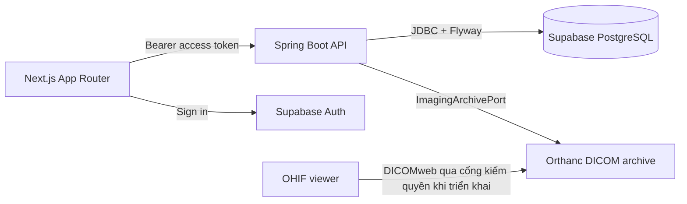

# Kiến trúc OTCMS

## Quyết định chính

Một repository, hai ứng dụng độc lập: Next.js và Spring Boot. Backend là **modular monolith** với Clean Architecture trong từng feature. Mỗi feature sở hữu luật nghiệp vụ, use case, port và adapter của mình. Package theo **feature**, không theo actor; Patient và Receptionist đều có thể gọi feature `appointment` với quyền khác nhau. Một Maven module giúp nhóm bắt đầu nhanh; chiều phụ thuộc hiện được giữ bằng quy ước/code review, chưa được compiler ép buộc.



## Backend

```text
backend/src/main/java/com/otcms/
├── OtcmsBackendApplication.java
├── shared/
│   ├── config/SecurityConfiguration.java
│   └── web/SystemController.java
├── account/
├── patient/
├── appointment/
├── schedule/
├── reception/
├── visit/
├── clinical/
├── imaging/
│   ├── domain/                        Entity, value object, quy tắc thuần Java
│   ├── application/
│   │   ├── port/in/                   Interface của use case
│   │   ├── port/out/ImagingArchivePort.java
│   │   └── service/                   Handler thực thi use case
│   └── adapter/
│       ├── in/web/                    Controller, request, response
│       └── out/{persistence,orthanc}/ Adapter JPA và DICOMweb
├── billing/
└── reporting/
```

Các folder feature ngoài `imaging` trong cây trên là vị trí dành cho UC tương ứng; tạo code khi triển khai UC, không thêm class rỗng. Quy tắc phụ thuộc: `domain` không biết framework; `application` dùng domain và khai báo port; `adapter` triển khai port và dùng framework. Controller không gọi JPA repository. Feature khác không truy cập trực tiếp bảng/adapter của feature chủ sở hữu.

Luồng mẫu cho một UC: `POST /api/v1/appointments` → `AppointmentController` → `CreateAppointmentUseCase` → `CreateAppointmentHandler` → `AppointmentRepository` → `JpaAppointmentRepositoryAdapter`. Cả quyền actor lẫn quyền trên bản ghi được kiểm tra trong backend.

Supabase Auth xác thực danh tính. `role` trong JWT là PostgreSQL role, **không phải** vai trò phòng khám. Bảng account của ứng dụng và chính sách use case sẽ giữ vai trò Patient/Receptionist/Orthopedic Doctor/Imaging Technician/Administrator/Clinic Owner. Không ánh xạ vai trò nhóm từ claim `role`.

## Frontend

```text
frontend/src/
├── app/
│   ├── global-not-found.tsx             404 cho URL không khớp route (nhiều root layout nên cần file riêng)
│   ├── global-error.tsx                 lỗi ở chính root layout
│   ├── (public)/                        root layout riêng, nạp cùng theme shadcn (styles/app-theme.css)
│   │   ├── layout.tsx, error.tsx
│   │   ├── (site)/                      trang công khai có header/footer chung: page.tsx (trang chủ), services/, doctors/, reviews/, announcements/, gioi-thieu/, bai-viet/[id]/ (+ loading/error/not-found)
│   │   ├── login/, register/, forgot-password/, reset-password/   UC01, UC06, UC02 (page.tsx mỏng, gọi features/auth; /login nhận ?next= trong /portal)
│   │   └── workspace/page.tsx           chuyển trang theo vai trò: bệnh nhân → /portal, Lễ tân → /staff, admin → /admin
│   ├── (patient)/                       khu bệnh nhân (/portal): root layout riêng, theme shadcn + font Be Vietnam Pro
│   │   ├── layout.tsx
│   │   └── portal/                      layout (PatientPortalHeader + một cột max-w-3xl + Toaster), page.tsx (trang chủ: khung + _home/), error.tsx, loading.tsx, not-found.tsx; các route của phase 01–08
│   │       ├── _home/                   private folder: ghép trang chủ từ nhiều feature (lượt khám, lịch hẹn, thanh toán, gợi ý hồ sơ); feature không import chéo nên việc ghép nằm ở app/
│   │       ├── visits/                  danh sách và chi tiết lượt khám (phase 05)
│   │       └── account/, profiles/, appointments/, payments/, results/, prescriptions/, images/, notifications/, reviews/
│   ├── (staff)/                         khu Lễ tân (/staff): root layout riêng; staff/ có sidebar + header công cụ
│   │   └── staff/                       check-in/ (UC29 + phí khám), reception-queue/ (UC30), appointments/ + appointments/new/ (UC10, UC21, UC22, UC24); page.tsx chuyển tới check-in
│   └── (admin)/                         root layout riêng: theme shadcn + font Be Vietnam Pro
│       ├── layout.tsx
│       └── admin/                       layout shell + 13 màn quản trị (UC07–UC79)
│           └── error.tsx, loading.tsx, not-found.tsx   hiển thị trong khung sidebar/header
├── features/
│   ├── clinic-website/                  nội dung website công khai (BR-68): SiteTopBar, SiteHeader, SiteFooter, các khối trang chủ (Home*), siteNavigation.ts, api giả
│   ├── clinic-services/                 danh mục dịch vụ công khai (BR-65): FeaturedServices, api giả
│   ├── doctor-profiles/                 hồ sơ bác sĩ công khai (BR-13): DoctorCard, FeaturedDoctors, api giả
│   ├── patient-reviews/                 đánh giá đã công khai (UC62–UC63, BR-60): FeaturedReviews, api giả
│   ├── auth/                            UC01/02/06: components (AuthCard, form, luồng đăng ký 3 bước), api (đăng nhập thật, còn lại giả), schema, authMessages
│   ├── admin-shell/                     sidebar (nhóm thu gọn), header, ô tài khoản, adminNavigation.ts (nguồn duy nhất cho menu)
│   ├── patient-shell/                   khu bệnh nhân: PatientPortalHeader, PatientPortalNav (menu nhóm + Sheet màn hẹp), PatientAccountMenu, patientNavigation.ts (nguồn duy nhất cho menu portal, chỉ khai báo mục đã có trang)
│   ├── clinic-visits/                   tiến độ lượt khám (UC34, BR-19/35/65): danh sách Đang diễn ra/Gần đây, chi tiết (số thứ tự từng phòng, chỉ định, nút thanh toán), hook tự tải lại 30 s khi tab hiện; api giả (kho tiến độ riêng)
│   ├── patient-profiles/                hồ sơ bệnh nhân trong cổng (UC12–UC15, BR-16/17): danh sách, gợi ý theo email đã xác minh, tạo/sửa/bỏ gắn, tiền sử; api giả (ghi vào kho gắn dùng chung), schema, hooks, components
│   ├── notifications/                   thông báo: chuông + Sheet admin, chuông + trang /portal/notifications (UC63), api giả
│   ├── staff-shell/                     khu Lễ tân: StaffSidebar, StaffHeader, StaffAccountMenu, staffNavigation.ts (nguồn duy nhất cho menu /staff)
│   ├── appointments/                    lịch hẹn: admin (danh sách, chuyển bác sĩ); booking* lõi đặt lịch dùng chung (BookingFlow variant patient/staff, bookingMockStore là kho lịch chung); components/portal (lịch hẹn bệnh nhân); components/staff (lịch hẹn Lễ tân)
│   ├── patients/                        tìm hồ sơ tại quầy (mã BN, SĐT + ngày sinh) và tạo hồ sơ vãng lai (UC10): PatientLookup ghép vào màn Lễ tân qua app/
│   ├── reception/                       tiếp nhận (check-in, thu phí khám tiền mặt/QR VNPay, phiếu số) và hàng đợi tiếp nhận; receptionMockStore là kho chung của hai màn
│   ├── billing/                         thanh toán: admin (lịch sử, khoản chưa trả); components/portal (khoản cần trả, VNPay, kết quả, lịch sử, phiếu thu)
│   ├── medical-records/                 kết quả khám khu bệnh nhân (UC41): danh sách, chi tiết theo visibleBlocks
│   ├── prescriptions/                   đơn thuốc khu bệnh nhân (UC44): danh sách, tài liệu đơn, in
│   ├── imaging/                         ảnh chụp khu bệnh nhân (UC51): danh sách study, mở viewer theo viewerUrl BE cấp
│   └── rooms/                           feature mẫu: types, api (giả), hooks, components
├── components/
│   ├── ui/                              shadcn/ui (sinh bằng CLI, ít sửa tay)
│   ├── brand/                           PublicSectionHeading, OtcmsLogo, publicButtonStyles (nút cỡ public dựng trên buttonVariants), publicLayout
│   ├── patient/                         khu bệnh nhân: ProfileScopeSelect (chọn người khám), PortalPageHeader, PortalEmptyState (+ trạng thái chưa có hồ sơ)
│   └── PageHeader.tsx                   UI dùng chung
├── hooks/
│   └── useLinkedProfiles.ts             hồ sơ đã gắn của tài khoản (chỉ đọc, tự tải lại khi kho đổi), dùng chung các khu
├── styles/
│   ├── brand-palette.css                mã màu Teal + Coral và font, mọi khu đều nạp
│   └── app-theme.css                    theme shadcn (token ánh xạ từ brand-palette, @layer base); chỉ root layout cần nó mới import
├── lib/
│   ├── api/client.ts                    Gọi Spring API kèm access token
│   ├── domain/                          enum, nhãn và tone dùng chung giữa các khu: clinicVisit.ts, careRelationship.ts, clinicRoles.ts, clinicCategories.ts
│   ├── patient-scope/                   hồ sơ đã gắn của tài khoản: API giả chỉ đọc và kho giả (ghi ở feature patient-profiles, không đặt luật ở đây)
│   ├── routes/                          đường dẫn theo khu (adminRoutes.ts, patientRoutes.ts, staffRoutes.ts), để feature không import navigation của nhau
│   ├── session/                         mockCurrentActor.ts, mockSignedInKind.ts: phiên giả để hiển thị (xóa khi có /api/v1/me)
│   ├── mock/                            kho giả dùng chung giữa feature (bệnh nhân tạo tại quầy, phí khám lịch hẹn) để mock hành xử như một DB; xóa khi nối BE
│   ├── fonts.ts                         Nạp font chung Be Vietnam Pro cho mọi root layout
│   └── supabase/browser.ts              Chỉ dùng Supabase Auth
└── test/setup.ts                        Thiết lập chung cho Vitest; `*.test.ts(x)` nằm cạnh mã nguồn
```

Chiều phụ thuộc frontend được ESLint ép buộc: `app` → `features` → `components`/`lib`/`hooks`; feature không import feature khác (trừ lớp ghép `admin-shell`), mã dùng chung không import ngược lên feature hay `app`. Chi tiết và cách mở rộng ở `AGENTS.md`.

Quy tắc màu sắc, chữ, bố cục và component khi dựng màn hình nằm ở [`ui-guidelines.md`](ui-guidelines.md). Hợp đồng API khu bệnh nhân, Lễ tân và trang công khai cho BE nằm ở [`fe-be-api-contract-patient-reception.md`](fe-be-api-contract-patient-reception.md).

Khu bệnh nhân gọi API theo phạm vi tài khoản: dữ liệu của chính tài khoản dưới `/api/v1/me/...` (hồ sơ đã gắn, thông báo); dữ liệu nghiệp vụ dưới `/api/v1/<nghiệp vụ>` (`/appointments`, `/visits`, `/payments`), BE lọc theo phạm vi người dùng. Không dùng tiền tố `/patient`. Phạm vi "người khám" (bản thân và người thân đã gắn) đọc qua `lib/patient-scope` và `useLinkedProfiles`; nhóm mã dùng chung này chỉ đọc, không chứa luật nghiệp vụ.

Khi triển khai một feature, đặt `components/`, `hooks/`, `api/`, `schema/` và `types/` bên trong `src/features/<feature>/` theo nhu cầu thực tế. Mỗi khu vực (public, patient, admin; staff sau này) là một route group `(tên)` có **root layout riêng** để CSS không lan sang khu khác; URL không đổi. Chuyển giữa hai khu là tải lại cả trang (hành vi của Next với nhiều root layout), còn trong một khu vẫn chuyển trang phía client. Hiện cả `(public)`, `(patient)` và `(admin)` đều import `styles/app-theme.css` trong root layout; khu mới cũng import file này để dùng chung component `components/ui`. Không tạo bản sao logic theo vai trò. `NEXT_PUBLIC_*` chỉ chứa thông tin công khai.

## DICOM/MRI

Orthanc lưu DICOM gốc; PostgreSQL lưu metadata, quan hệ bệnh nhân/lượt khám và trạng thái phát hành. OHIF chạy riêng để tránh xung đột dependency với Next.js. Compose hiện tạo một phòng thí nghiệm local cùng reverse proxy để OHIF gọi DICOMweb cùng origin. Đây chưa phải đường truy cập ảnh của bệnh nhân.

Khi triển khai UC hình ảnh: nhân viên upload → backend ghi nhận study UID và liên kết lượt khám → kỹ thuật viên/bác sĩ kiểm tra → phát hành → backend cấp quyền xem đúng study cho đúng người. Cần chặn truy cập DICOMweb trực tiếp ở môi trường triển khai và kiểm tra quyền cho QIDO/WADO/STOW, gồm cả thumbnail, metadata và frame. Không đưa ảnh DICOM vào Supabase Database hoặc Git.
