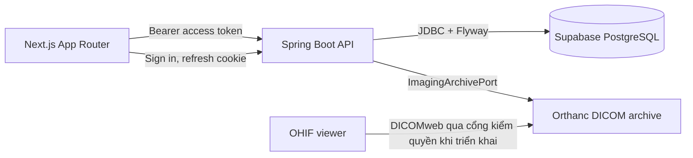
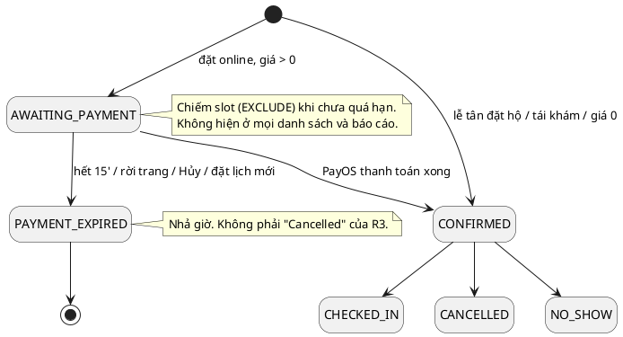
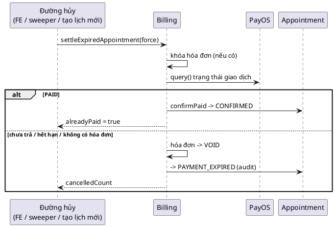

# Kiến trúc OTCMS

## Quyết định chính

Một repository, hai ứng dụng độc lập: Next.js và Spring Boot. Backend là **modular monolith** theo **Spring layered architecture** (`backend/CONSTITUTION.md`, ARCH-01). Mỗi feature sở hữu controller, service, repository, entity và DTO của mình. Package theo **feature**, không theo actor; Patient và Receptionist đều có thể gọi feature `appointment` với quyền khác nhau. Một Maven module giúp nhóm bắt đầu nhanh; chiều phụ thuộc hiện được giữ bằng quy ước/code review, chưa được compiler ép buộc.



## Backend

```text
backend/src/main/java/fu/fa26/sep490/g58/otcms_be/
├── OtcmsBeApplication.java
├── config/                            Cấu hình tập trung (SecurityConfig, OpenAPI, properties)
├── common/                            Mã dùng chung: security, exception, repository, web
├── auth/ patient/ appointment/        Mỗi feature chia theo lớp như `review` dưới đây
├── visit/ staff/ servicecatalog/
├── billing/ notification/ review/
│   ├── controller/                    Controller: HTTP, validate/map, gọi service
│   ├── service/                       Interface service (nghiệp vụ, quyền, transaction)
│   │   └── impl/                      Cài đặt service
│   ├── repository/                    Spring Data JPA / truy vấn có tham số
│   ├── model/
│   │   ├── entity/                    JPA entity
│   │   └── dto/                       Request/response (record)
│   ├── exception/                     Exception nghiệp vụ mang mã MSG và handler ánh xạ HTTP
│   ├── mapper/                        Map entity ↔ DTO khi cần
│   └── integration/                   Client dịch vụ ngoài khi cần (ví dụ billing/integration/payos)
└── imaging/ clinical/ reporting/      Thêm khi triển khai UC tương ứng
```

Tạo code khi triển khai UC, không thêm class rỗng. Quy tắc phụ thuộc (ARCH-01): `controller → service → repository → entity`. Controller không gọi repository và không trả entity; service không biết mã HTTP; entity không phụ thuộc web hay DTO. Feature khác gọi service công khai của feature chủ sở hữu, không truy cập trực tiếp repository hay bảng của feature đó.

Luồng mẫu cho một UC: `POST /api/v1/reviews` → `PatientReviewController` → `ReviewService` → `ReviewServiceImpl` → `PatientReviewRepository` → `PatientReviewJpaEntity`. Cả quyền actor lẫn quyền trên bản ghi được kiểm tra trong backend.

Backend tự xác thực danh tính (email + mật khẩu băm bcrypt trong bảng account) và phát JWT access token sống ngắn cùng refresh token trong cookie httpOnly; Supabase chỉ cung cấp PostgreSQL. Frontend giữ access token trong bộ nhớ (`lib/auth/authSession.ts`) và gửi CSRF cho `/refresh`, `/logout`. Vai trò phòng khám nằm trong JWT do backend ký và trong bảng account, **không phải** PostgreSQL role. Bảng account của ứng dụng và chính sách use case sẽ giữ vai trò Patient/Receptionist/Orthopedic Doctor/Imaging Technician/Administrator/Clinic Owner. Không ánh xạ vai trò nhóm từ claim `role`.

Khu Chủ phòng khám dùng root layout `(owner)` và `/owner/accounts`, giao diện khung ở `features/owner-shell`, nghiệp vụ ở `features/owner-administrators`. Hai feature được ghép tại route layout, không import lẫn nhau. OWNER được điều hướng vào khu này sau đăng nhập. Chi tiết UC07–UC09 đối chiếu SRS (4) và giới hạn tích hợp: [owner-administrator-frontend.md](owner-administrator-frontend.md).

## Appointment: giữ giờ chờ thanh toán (migration V106)

Kế hoạch gốc: `plans/261108-2017-booking-payment-hold-awaiting-payment/`. Tài liệu này ghi kiến trúc đã chốt; hợp đồng API ở [`fe-be-api-contract-patient-reception.md`](fe-be-api-contract-patient-reception.md) (mục "Giữ giờ chờ thanh toán"), cột/ràng buộc ở [`otcms-schema-design.md`](otcms-schema-design.md).

**Khi nào áp dụng.** Đặt lịch online (`booking_source = PATIENT_ONLINE`) với dịch vụ giá > 0 tạo lịch ở trạng thái kỹ thuật `AWAITING_PAYMENT`, giữ giờ đến `payment_deadline = now + 15 phút`. Chỉ khi thanh toán PayOS xong lịch mới thành `CONFIRMED`. Lễ tân đặt hộ, bác sĩ tái khám, dịch vụ giá 0 → `CONFIRMED` ngay, không qua hold. Đặt online có phí phải cách giờ khám ít nhất 15 phút (lỗi `BOOKING_TOO_SOON`).

### Vòng đời trạng thái



Các trạng thái sau `CONFIRMED` không đổi (`CHECKED_IN`, `CANCELLED`, `NO_SHOW`, ...). `AWAITING_PAYMENT` và `PAYMENT_EXPIRED` là trạng thái kỹ thuật: không bệnh nhân, bác sĩ, lễ tân, admin nào thấy ở danh sách hay báo cáo; chủ lịch chỉ đọc qua `GET /api/v1/appointments/{id}` (màn thanh toán, bước 5). Nhắc lịch, check-in, đổi lịch/đổi bác sĩ, vắng mặt chỉ nhận `CONFIRMED`; báo cáo loại cả hai trạng thái; màn Payment Items không liệt kê khoản của lịch đang giữ.

### Chiếm slot

Ràng buộc `ex_appointments_doctor_occupied_range` (V013, mở rộng ở V106) tính cả `AWAITING_PAYMENT`; `PAYMENT_EXPIRED` không tính nên nhả giờ. EXCLUDE không dùng `now()`, nên truy vấn occupancy bỏ qua `AWAITING_PAYMENT` đã quá `payment_deadline`, và lúc tạo lịch BE hủy lười mọi hold quá hạn trùng bác sĩ và khoảng giờ trước khi insert.

### Các đường nhả hold

Xếp từ chắc đến yếu:

| # | Đường | Ghi chú |
| --- | --- | --- |
| 1 | FE khu bệnh nhân mount (tải trang, reload, đăng nhập lại) gọi `POST /api/v1/appointments/pending-hold/cancel` | Chắc nhất; idempotent, có CSRF |
| 2 | Rời trang trong app (link, Back) | Hộp thoại xác nhận; đồng ý thì hủy |
| 3 | Đóng tab | `fetch keepalive` lúc `pagehide`, best-effort (cần CSRF nên không dùng `sendBeacon`) |
| 4 | Hết hạn | Sweeper theo `payment_deadline`: lưới an toàn cuối |
| 5 | Tạo lịch mới | Tự hủy mọi hold sống của cùng tài khoản trong cùng transaction → tối đa 1 hold/tài khoản |

Bấm "Hủy" hoặc "Quay lại" ở bước 5, và đăng xuất, cũng là hủy thanh toán (`POST /api/v1/appointments/{id}/cancel` hủy được `AWAITING_PAYMENT`, không áp `APPOINTMENT_CHANGE_TOO_LATE`).

Mọi đường đều qua `settleExpiredAppointment(force)` của billing:



Sweeper (`ExpireUnpaidAppointmentsJob`) chọn `AWAITING_PAYMENT` quá hạn theo lô (index `ix_appointments_awaiting_deadline`), mỗi lịch một transaction; lỗi một lịch không dừng cả lô. Audit hủy tự động dùng `actor_type = 'SYSTEM'`.

### Cấu hình

| Key (`appointment.booking.*`) | Biến môi trường | Ý nghĩa |
| --- | --- | --- |
| `payment-hold-minutes` | `APPOINTMENT_BOOKING_PAYMENT_HOLD_MINUTES` | Thời gian giữ giờ (15) |
| `payment-hold-sweep-ms` | `APPOINTMENT_BOOKING_PAYMENT_HOLD_SWEEP_MS` | Chu kỳ quét của sweeper |
| `payment-hold-sweep-enabled` | – | Tắt sweeper khi rollback nhanh |

### Thanh toán và trả muộn

- Hạn QR PayOS = `min(now + TTL link, payment_deadline)`.
- Hóa đơn `VOID` thì `createOnlineAttempt` ném `INVOICE_NOT_PAYABLE`: không tạo được QR mới.
- Tiền về sau khi hóa đơn `VOID` hoặc hold đã hết (chuyển khoản trễ): webhook/đối soát **không** lật `VOID` thành `PAID`, đánh `RECONCILIATION_REQUIRED` (R3 NF-06, lễ tân đối soát tại quầy), **không** tự hoàn tiền (BR-53 giữ nguyên). Webhook luôn trả 2xx và không ném lỗi ra ngoài.
- Thứ tự khóa (tránh deadlock): **hóa đơn trước, lịch sau**, ở webhook, sweeper và hủy.
- Giá quyết định hold lấy lúc tạo lịch, giá chốt trên hóa đơn (`invoice_items.unit_price_snapshot`) lấy lúc tạo hóa đơn ở bước 5; chấp nhận lệch vài giây.

### Rollout và rollback

- Rollout: BE và FE triển khai cùng lúc.
- Tắt nhanh: `payment-hold-sweep-enabled=false` hoặc tăng `payment-hold-minutes`.
- Gỡ hẳn: chuyển mọi `AWAITING_PAYMENT` sang `CANCELLED` và `VOID` hóa đơn tương ứng, rồi migration V107 gỡ hai giá trị khỏi CHECK/EXCLUDE và revert code. Migration V106 không tự đảo được.

## Frontend

```text
frontend/src/
├── app/
│   ├── global-not-found.tsx             404 cho URL không khớp route (nhiều root layout nên cần file riêng)
│   ├── global-error.tsx                 lỗi ở chính root layout
│   ├── (public)/                        root layout riêng, nạp cùng theme shadcn (styles/app-theme.css)
│   │   ├── layout.tsx, error.tsx
│   │   ├── (site)/                      trang công khai có header/footer chung: page.tsx (trang chủ), services/, doctors/, reviews/, announcements/, gioi-thieu/, bai-viet/[id]/ (+ loading/error/not-found)
│   │   ├── login/, register/, forgot-password/, reset-password/   UC01, UC06, UC02 (page.tsx mỏng, gọi features/auth; /login nhận ?next= trong /portal)
│   │   └── workspace/page.tsx           chuyển trang theo vai trò: bệnh nhân → /portal, Lễ tân → /reception, admin → /admin
│   ├── (patient)/                       khu bệnh nhân (/portal): root layout riêng, theme shadcn + font Be Vietnam Pro
│   │   ├── layout.tsx
│   │   └── portal/                      layout (PatientPortalHeader + một cột max-w-3xl + Toaster), error.tsx, loading.tsx, not-found.tsx; các route của phase 01–08
│   │       ├── visits/                  danh sách và chi tiết lượt khám (phase 05)
│   │       └── account/, profiles/, appointments/, payments/, results/, prescriptions/, images/, notifications/, reviews/
│   ├── (staff)/                         khu Lễ tân: root layout riêng, staff.css (in A4 biên lai/phiếu kết quả)
│   │   ├── imaging/                     route mỏng, layout ghép imaging-shell; error/loading/not-found
│   │   └── reception/                   layout (ReceptionShell), page.tsx (Tiếp nhận hôm nay), [section]/ (14 màn theo patient-reception/navigation.ts), error/loading/not-found
│   └── (admin)/                         root layout riêng: theme shadcn + font Be Vietnam Pro
│       ├── layout.tsx
│       └── admin/                       layout shell + 13 màn quản trị (UC07–UC79)
│           └── error.tsx, loading.tsx, not-found.tsx   hiển thị trong khung sidebar/header
├── features/
│   ├── clinic-website/                  nội dung website công khai (BR-68): SiteTopBar, SiteHeader, SiteFooter, các khối trang chủ (Home*), siteNavigation.ts, api giả
│   ├── clinic-services/                 danh mục dịch vụ công khai (BR-65): FeaturedServices, api giả
│   ├── doctor-profiles/                 hồ sơ bác sĩ công khai (BR-13): DoctorCard, FeaturedDoctors, api giả
│   ├── patient-reviews/                 đánh giá đã công khai (UC62–UC63, BR-60): FeaturedReviews, api giả
│   ├── auth/                            UC01/02/06: components (AuthCard, form, luồng đăng ký 3 bước), api (đăng nhập thật, còn lại giả), schema, authMessages
│   ├── admin-shell/                     sidebar (nhóm thu gọn), header, ô tài khoản, adminNavigation.ts (nguồn duy nhất cho menu)
│   ├── imaging-shell/                   sidebar, header, navigation và menu kỹ thuật viên theo mẫu admin-shell
│   ├── patient-shell/                   khu bệnh nhân: PatientPortalHeader, PatientPortalNav (menu nhóm + Sheet màn hẹp), PatientAccountMenu, patientNavigation.ts (nguồn duy nhất cho menu portal, chỉ khai báo mục đã có trang)
│   ├── clinic-visits/                   tiến độ lượt khám (UC34, BR-19/35/65): danh sách Đang diễn ra/Gần đây, chi tiết (số thứ tự từng phòng, chỉ định, nút thanh toán), hook tự tải lại 30 s khi tab hiện; api giả (kho tiến độ riêng)
│   ├── patient-profiles/                hồ sơ bệnh nhân trong cổng (UC12–UC15, BR-16/17): danh sách, gợi ý theo email đã xác minh, tạo/sửa/bỏ gắn, tiền sử; api giả (ghi vào kho gắn dùng chung), schema, hooks, components
│   ├── notifications/                   thông báo: chuông + Sheet admin, chuông + trang /portal/notifications (UC63), api giả
│   ├── appointments/                    lịch hẹn: admin (danh sách, chuyển bác sĩ); booking* lõi đặt lịch dùng chung (BookingFlow, bookingMockStore là kho lịch chung); components/portal (lịch hẹn bệnh nhân)
│   ├── patient-reception/               khu Lễ tân /reception (xem docs/receptionist-ui.md): ReceptionShell (cùng khung admin qua components/shell) + ReceptionAccountMenu + navigation.ts (menu), các màn hồ sơ/lịch hẹn/tiếp nhận/hàng đợi/thu phí/tra cứu; api/receptionApi.ts là adapter lệnh giả (lỗi mang mã MSG), schema/receptionMessages.ts ánh xạ lệnh → MSG thành công
│   ├── billing/                         thanh toán: admin (lịch sử, khoản chưa trả); components/portal (khoản cần trả, PayOS, kết quả, lịch sử, phiếu thu)
│   ├── medical-records/                 kết quả khám khu bệnh nhân (UC41): danh sách, chi tiết theo visibleBlocks
│   ├── prescriptions/                   đơn thuốc khu bệnh nhân (UC44): danh sách, tài liệu đơn, in
│   ├── imaging/                         màn kỹ thuật viên (components/hooks/api/schema/types/styles) và ảnh chụp khu bệnh nhân (UC51)
│   └── rooms/                           feature mẫu: types, api (giả), hooks, components
├── components/
│   ├── ui/                              shadcn/ui (sinh bằng CLI, ít sửa tay)
│   ├── brand/                           PublicSectionHeading, OtcmsLogo, publicButtonStyles (nút cỡ public dựng trên buttonVariants), publicLayout
│   ├── shell/                           khung chung khu nhân viên (admin, lễ tân): SidebarNavGroup (nhóm menu thu gọn, gạch xanh mục đang mở), CurrentDateTime, UnreadCountBadge
│   ├── patient/                         khu bệnh nhân: ProfileScopeSelect (chọn người khám), PortalPageHeader, PortalEmptyState (+ trạng thái chưa có hồ sơ)
│   └── PageHeader.tsx                   UI dùng chung
├── hooks/
│   └── useLinkedProfiles.ts             hồ sơ đã gắn của tài khoản (chỉ đọc, tự tải lại khi kho đổi), dùng chung các khu
├── styles/
│   ├── brand-palette.css                mã màu Teal + Coral và font, mọi khu đều nạp
│   └── app-theme.css                    theme shadcn (token ánh xạ từ brand-palette, @layer base); chỉ root layout cần nó mới import
├── lib/
│   ├── api/client.ts                    Gọi Spring API kèm access token
│   ├── domain/                          enum, nhãn và tone dùng chung giữa các khu: clinicVisit.ts, careRelationship.ts, clinicRoles.ts, clinicCategories.ts
│   ├── patient-scope/                   hồ sơ đã gắn của tài khoản: API giả chỉ đọc và kho giả (ghi ở feature patient-profiles, không đặt luật ở đây)
│   ├── routes/                          đường dẫn theo khu (adminRoutes.ts, patientRoutes.ts, staffRoutes.ts), để feature không import navigation của nhau
│   ├── session/                         mockCurrentActor.ts, mockSignedInKind.ts: phiên giả để hiển thị (xóa khi có /api/v1/me)
│   ├── mock/                            kho giả dùng chung giữa feature (bệnh nhân tạo tại quầy, phí khám lịch hẹn) để mock hành xử như một DB; xóa khi nối BE
│   ├── fonts.ts                         Nạp font chung Be Vietnam Pro cho mọi root layout
│   └── auth/authSession.ts              Phiên đăng nhập backend (token trong bộ nhớ, refresh, CSRF)
└── test/setup.ts                        Thiết lập chung cho Vitest; `*.test.ts(x)` nằm cạnh mã nguồn
```

Chiều phụ thuộc frontend được ESLint ép buộc: `app` → `features` → `components`/`lib`/`hooks`; feature không import feature khác (trừ lớp ghép `admin-shell`, `imaging-shell`), mã dùng chung không import ngược lên feature hay `app`. Chi tiết và cách mở rộng ở `AGENTS.md`.

Quy tắc màu sắc, chữ, bố cục và component khi dựng màn hình nằm ở [`ui-guidelines.md`](ui-guidelines.md). Hợp đồng API khu bệnh nhân, Lễ tân và trang công khai cho BE nằm ở [`fe-be-api-contract-patient-reception.md`](fe-be-api-contract-patient-reception.md).

Khu bệnh nhân gọi API theo phạm vi tài khoản: dữ liệu của chính tài khoản dưới `/api/v1/me/...` (hồ sơ đã gắn, thông báo); dữ liệu nghiệp vụ dưới `/api/v1/<nghiệp vụ>` (`/appointments`, `/visits`, `/payments`), BE lọc theo phạm vi người dùng. Không dùng tiền tố `/patient`. Phạm vi "người khám" (bản thân và người thân đã gắn) đọc qua `lib/patient-scope` và `useLinkedProfiles`; nhóm mã dùng chung này chỉ đọc, không chứa luật nghiệp vụ.

Khi triển khai một feature, đặt `components/`, `hooks/`, `api/`, `schema/` và `types/` bên trong `src/features/<feature>/` theo nhu cầu thực tế. Mỗi khu vực (public, patient, admin; staff sau này) là một route group `(tên)` có **root layout riêng** để CSS không lan sang khu khác; URL không đổi. Chuyển giữa hai khu là tải lại cả trang (hành vi của Next với nhiều root layout), còn trong một khu vẫn chuyển trang phía client. Hiện cả `(public)`, `(patient)` và `(admin)` đều import `styles/app-theme.css` trong root layout; khu mới cũng import file này để dùng chung component `components/ui`. Không tạo bản sao logic theo vai trò. `NEXT_PUBLIC_*` chỉ chứa thông tin công khai.

## DICOM/MRI

Orthanc lưu DICOM gốc; PostgreSQL lưu metadata, quan hệ bệnh nhân/lượt khám và trạng thái phát hành. OHIF chạy riêng để tránh xung đột dependency với Next.js. Compose hiện tạo một phòng thí nghiệm local cùng reverse proxy để OHIF gọi DICOMweb cùng origin. Đây chưa phải đường truy cập ảnh của bệnh nhân.

Khi triển khai UC hình ảnh: nhân viên upload → backend ghi nhận study UID và liên kết lượt khám → kỹ thuật viên/bác sĩ kiểm tra → phát hành → backend cấp quyền xem đúng study cho đúng người. Cần chặn truy cập DICOMweb trực tiếp ở môi trường triển khai và kiểm tra quyền cho QIDO/WADO/STOW, gồm cả thumbnail, metadata và frame. Không đưa ảnh DICOM vào Supabase Database hoặc Git.
