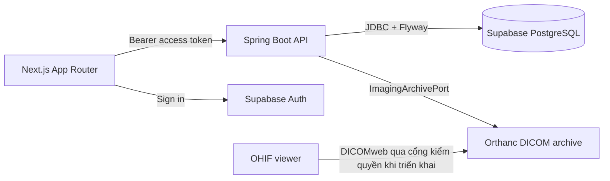

# Kiến trúc OTCMS

## Quyết định chính

Một repository, hai ứng dụng độc lập: Next.js và Spring Boot. Backend là **modular monolith** với Clean Architecture trong từng feature. Mỗi feature sở hữu luật nghiệp vụ, use case, port và adapter của mình. Package theo **feature**, không theo actor; Patient và Receptionist đều có thể gọi feature `appointment` với quyền khác nhau. Một Maven module giúp nhóm bắt đầu nhanh; chiều phụ thuộc hiện được giữ bằng quy ước/code review, chưa được compiler ép buộc.



## Backend

```text
backend/src/main/java/com/otcms/
├── OtcmsBackendApplication.java
├── shared/
│   ├── config/SecurityConfiguration.java
│   └── web/SystemController.java
├── account/
├── patient/
├── appointment/
├── schedule/
├── reception/
├── visit/
├── clinical/
├── imaging/
│   ├── domain/                        Entity, value object, quy tắc thuần Java
│   ├── application/
│   │   ├── port/in/                   Interface của use case
│   │   ├── port/out/ImagingArchivePort.java
│   │   └── service/                   Handler thực thi use case
│   └── adapter/
│       ├── in/web/                    Controller, request, response
│       └── out/{persistence,orthanc}/ Adapter JPA và DICOMweb
├── billing/
└── reporting/
```

Các folder feature ngoài `imaging` trong cây trên là vị trí dành cho UC tương ứng; tạo code khi triển khai UC, không thêm class rỗng. Quy tắc phụ thuộc: `domain` không biết framework; `application` dùng domain và khai báo port; `adapter` triển khai port và dùng framework. Controller không gọi JPA repository. Feature khác không truy cập trực tiếp bảng/adapter của feature chủ sở hữu.

Luồng mẫu cho một UC: `POST /api/v1/appointments` → `AppointmentController` → `CreateAppointmentUseCase` → `CreateAppointmentHandler` → `AppointmentRepository` → `JpaAppointmentRepositoryAdapter`. Cả quyền actor lẫn quyền trên bản ghi được kiểm tra trong backend.

Supabase Auth xác thực danh tính. `role` trong JWT là PostgreSQL role, **không phải** vai trò phòng khám. Bảng account của ứng dụng và chính sách use case sẽ giữ vai trò Patient/Receptionist/Orthopedic Doctor/Imaging Technician/Administrator/Clinic Owner. Không ánh xạ vai trò nhóm từ claim `role`.

## Frontend

```text
frontend/src/
├── app/
│   ├── global-not-found.tsx             404 cho URL không khớp route (nhiều root layout nên cần file riêng)
│   ├── global-error.tsx                 lỗi ở chính root layout
│   ├── (public)/                        root layout riêng, nạp cùng theme shadcn (styles/app-theme.css)
│   │   ├── layout.tsx, error.tsx
│   │   ├── (site)/                      trang giới thiệu có header/footer chung: layout.tsx, page.tsx (trang chủ); sau này doctors/, services/
│   │   ├── login/, register/, forgot-password/, reset-password/   UC01, UC06, UC02 (page.tsx mỏng, gọi features/auth)
│   │   └── workspace/page.tsx
│   ├── (staff)/                         root layout dùng chung theme và font cho lễ tân/kỹ thuật viên
│   │   ├── layout.tsx, staff.css
│   │   ├── reception/
│   │   └── imaging/                     page.tsx mỏng; layout ghép imaging-shell; có error/loading/not-found
│   └── (admin)/                         root layout riêng: theme shadcn + font Be Vietnam Pro
│       ├── layout.tsx
│       └── admin/                       layout shell + 13 màn quản trị (UC07–UC79)
│           └── error.tsx, loading.tsx, not-found.tsx   hiển thị trong khung sidebar/header
├── features/
│   ├── clinic-website/                  nội dung website công khai (BR-68): SiteTopBar, SiteHeader, SiteFooter, các khối trang chủ (Home*), siteNavigation.ts, api giả
│   ├── clinic-services/                 danh mục dịch vụ công khai (BR-65): FeaturedServices, api giả
│   ├── doctor-profiles/                 hồ sơ bác sĩ công khai (BR-13): DoctorCard, FeaturedDoctors, api giả
│   ├── patient-reviews/                 đánh giá đã công khai (UC62–UC63, BR-60): FeaturedReviews, api giả
│   ├── auth/                            UC01/02/06: components (AuthCard, form, luồng đăng ký 3 bước), api (đăng nhập thật, còn lại giả), schema, authMessages
│   ├── admin-shell/                     sidebar (nhóm thu gọn), header, ô tài khoản, adminNavigation.ts (nguồn duy nhất cho menu)
│   ├── imaging-shell/                   cùng mẫu admin-shell: sidebar, nhóm menu, header, ô tài khoản, imagingNavigation.ts
│   ├── imaging/                         components theo từng màn; hooks cho trạng thái; api cho dữ liệu mẫu/storage/file; schema, types, styles
│   ├── notifications/                   chuông thông báo (UC64), api giả
│   └── rooms/                           feature mẫu: types, api (giả), hooks, components
├── components/
│   ├── ui/                              shadcn/ui (sinh bằng CLI, ít sửa tay)
│   ├── brand/                           PublicSectionHeading, OtcmsLogo, publicButtonStyles (nút cỡ public dựng trên buttonVariants), publicLayout
│   └── PageHeader.tsx                   UI dùng chung
├── styles/
│   ├── brand-palette.css                mã màu Teal + Coral và font, mọi khu đều nạp
│   └── app-theme.css                    theme shadcn (token ánh xạ từ brand-palette, @layer base); chỉ root layout cần nó mới import
├── lib/
│   ├── api/client.ts                    Gọi Spring API kèm access token
│   ├── fonts.ts                         Nạp font chung Be Vietnam Pro cho mọi root layout
│   └── supabase/browser.ts              Chỉ dùng Supabase Auth
└── test/setup.ts                        Thiết lập chung cho Vitest; `*.test.ts(x)` nằm cạnh mã nguồn
```

Chiều phụ thuộc frontend được ESLint ép buộc: `app` → `features` → `components`/`lib`/`hooks`; feature không import feature khác (trừ lớp ghép `admin-shell`, `imaging-shell`), mã dùng chung không import ngược lên feature hay `app`. Feature nghiệp vụ không import shell. Chi tiết và cách mở rộng ở `AGENTS.md`.

Quy tắc màu sắc, chữ, bố cục và component khi dựng màn hình nằm ở [`ui-guidelines.md`](ui-guidelines.md).

Khi triển khai một feature, đặt `components/`, `hooks/`, `api/`, `schema/` và `types/` bên trong `src/features/<feature>/` theo nhu cầu thực tế. Mỗi khu vực (public, admin, sau này patient/staff) là một route group `(tên)` có **root layout riêng** để CSS không lan sang khu khác; URL không đổi. Chuyển giữa hai khu là tải lại cả trang (hành vi của Next với nhiều root layout), còn trong một khu vẫn chuyển trang phía client. Hiện cả `(public)` và `(admin)` đều import `styles/app-theme.css` trong root layout; khu mới cũng import file này để dùng chung component `components/ui`. Không tạo bản sao logic theo vai trò. `NEXT_PUBLIC_*` chỉ chứa thông tin công khai.

## DICOM/MRI

Orthanc lưu DICOM gốc; PostgreSQL lưu metadata, quan hệ bệnh nhân/lượt khám và trạng thái phát hành. OHIF chạy riêng để tránh xung đột dependency với Next.js. Compose hiện tạo một phòng thí nghiệm local cùng reverse proxy để OHIF gọi DICOMweb cùng origin. Đây chưa phải đường truy cập ảnh của bệnh nhân.

Khi triển khai UC hình ảnh: nhân viên upload → backend ghi nhận study UID và liên kết lượt khám → kỹ thuật viên/bác sĩ kiểm tra → phát hành → backend cấp quyền xem đúng study cho đúng người. Cần chặn truy cập DICOMweb trực tiếp ở môi trường triển khai và kiểm tra quyền cho QIDO/WADO/STOW, gồm cả thumbnail, metadata và frame. Không đưa ảnh DICOM vào Supabase Database hoặc Git.
